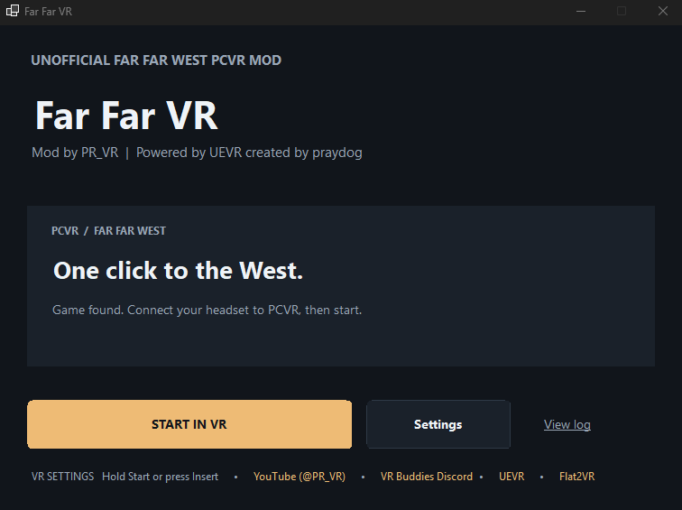
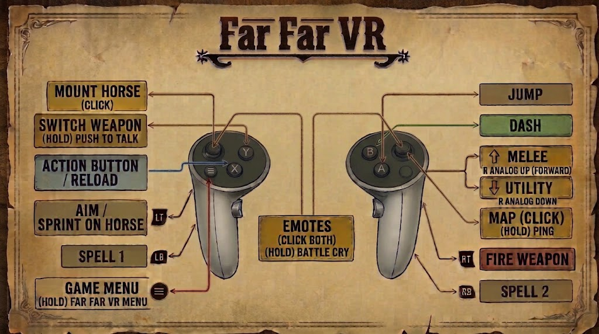

# Far Far VR

A community **PCVR mod for Far Far West on Steam**, created by [PR_VR](https://www.youtube.com/@PR_VR). Powered by [UEVR](https://github.com/praydog/UEVR), created by praydog.

**[Download Far Far VR 0.4.11](https://github.com/pr-io/Far-Far-VR/releases/download/v0.4.11/FarFarVR-v0.4.11.zip)** · [Release notes](https://github.com/pr-io/Far-Far-VR/releases/latest) · [VR Buddies Discord](https://discord.gg/PcsYNa6MS9)

Download the release ZIP above. GitHub's **Code Download ZIP** contains source code, not the playable mod.

## Requirements

- Windows 10/11, 64-bit, and a purchased Steam copy of [Far Far West](https://store.steampowered.com/app/3124540/Far_Far_West/).
- A PCVR-capable headset connected to the PC, with its OpenXR runtime active.
- Internet access for the first runtime download and updates.

This runs the Windows game in PCVR; it is not a standalone Quest app. Performance depends on your PC, headset resolution and game settings. The mod is early access, and game updates may affect compatibility.

See [what changed in v0.4.11](docs/RELEASE-0.4.11.md), including the latest launcher and shutdown updates.

## Install and play

1. Download and extract the **entire** Far Far VR release ZIP to its own folder.
2. Run **Far Far VR.exe** and confirm the detected Steam game folder in Settings.
3. Connect your headset to PCVR and activate its OpenXR runtime.
4. Click **START IN VR**. First setup automatically downloads, customizes and verifies the required runtime, installs the VR profile, and starts the game. Wait for setup to finish.
5. Hold **Start** or press **Insert** to open the **Far Far VR menu**. Use **Calibration** to adjust height and position.

Keep the executable, `Profile`, `Runtime` and `UE5.8` folders together. No compiler, developer tools, separate .NET installation or manual DLL copying is needed.

## Features

- Independent tracked-hand weapon aiming, weapon-following crosshair and hit markers.
- Head-based objective markers and separate full-face dash/damage effects.
- VR controls with distinct tap, hold and two-stick actions.
- Far Far VR settings menu, controls guide, calibration and live comfort/display adjustments.
- Separate VR and flat-game graphics and controller settings.
- Camera handling for riding, emotes, cutscenes and level transitions.
- Automatic runtime setup and updates from the desktop launcher or headset menu.

## Controls

- **Start:** tap for the game menu; hold for the Far Far VR menu.
- **Right stick click:** tap for the map; hold for 0.5 seconds to ping.
- **Y:** tap to switch weapons; hold for 0.5 seconds for push-to-talk.
- **Both sticks:** click together for emotes; hold for 0.5 seconds for battle cry. **A** confirms an emote.
- **Cursor menus:** point with a controller and pull its trigger to select. Move a thumbstick to return to gamepad navigation.

The controls image is also available in the Far Far VR menu. Use **Recenter view** when you need to reset facing; it does not change calibrated height. Save settings in the menu to retain your adjustments.

## Updates

On your desktop, open **Far Far VR.exe > Updates > Check for updates**. If an update is available, select **Download update**. Close Far Far West, then select **Install & restart**. The launcher installs the update and reopens automatically.

You can cancel a check or download with **Cancel** in the desktop Updates window. If a download stops responding, it times out so you can check for updates and try again.

In your headset, open **Far Far VR menu > Updates > Check for Updates**, then choose **Download & Prepare Update**. Exit the game and reopen the launcher to install the prepared update.

You can also get the complete package from [Releases](https://github.com/pr-io/Far-Far-VR/releases). Keep a backup before replacing an existing installation. Fully exit VR before starting the flat game so the launcher can restore its desktop settings.

## Troubleshooting and feedback

- **Headset not detected or game starts flat:** connect PCVR and check which OpenXR runtime is active before launching again.
- **Missing files or runtime setup failure:** extract the complete release ZIP, keep its folders together, and check your internet connection. Do not mix runtime DLLs from different builds.
- **Wrong game folder:** select the Steam installation folder again in launcher Settings.
- **Facing or height feels wrong:** use Recenter view and Calibration in the VR menu before changing camera offsets.
- **Reporting a problem:** use [GitHub Issues](https://github.com/pr-io/Far-Far-VR/issues) or [Discord](https://discord.gg/PcsYNa6MS9). Include your mod version, headset, OpenXR runtime, GPU and the steps that caused it. Remove personal information before sharing logs.

## Credits and runtime patch

Far Far VR by [PR_VR](https://www.youtube.com/@PR_VR). UEVR by [praydog](https://github.com/praydog/UEVR); upstream compatibility patch by [joeyhodge](https://github.com/joeyhodge/UEVR). Thanks to the [Flat2VR](https://flat2vr.com/) community.

First setup downloads the public [102626_FFR_SWGR_Patch release](https://github.com/joeyhodge/UEVR/releases/tag/102626_FFR_SWGR_Patch) directly from upstream and applies the bundled [Far Far VR customization patch](https://github.com/pr-io/Far-Far-VR/releases/download/v0.4.11/backend.ffvrdelta). The launcher verifies the exact resulting engine. Complete upstream runtime DLLs are not bundled in the mod ZIP.

Far Far VR is unofficial and is not endorsed by the game developers, Epic Games or the upstream authors. Upstream retains its rights. See [third-party notices](THIRD_PARTY.md) for source links, hashes and licensing information.

## Source and development

Players only need the release download. The source repository includes regression tests to help prevent fixes from breaking; these are not included in the player package. Build and test instructions are in the [developer guide](https://github.com/pr-io/Far-Far-VR/blob/main/BUILD.md).
